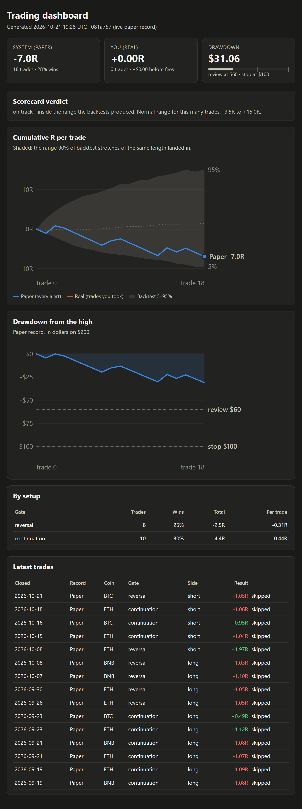
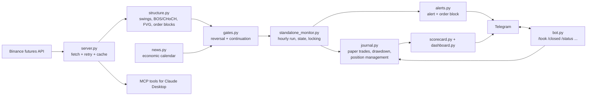

# Crypto Futures Setup Monitor

[](https://github.com/Chamara-Dilshan/ai-analysis/actions/workflows/tests.yml)

A trading assistant for Binance USDT-M perpetual futures. It runs 24/7 on a cloud VM: every hour it reads market
structure on five coins, sends an alert to Telegram when a complete, rule-based setup appears, manages any trade
you take, and keeps an honest forward record that is checked every week against what the backtests predicted.

The interesting part is not the strategy. It's the method: a backtester rebuilt after finding a look-ahead bug,
ten strategy ideas tested out of sample and rejected, a rule fixed *before* the data was looked at, and fifteen
silent production bugs fixed with tests that fail on the old code. **→ [Read the case study](Docs/CASE_STUDY.md)**

> **Not financial advice.** This is a personal research and engineering project. It does not place orders, and
> nothing here is a recommendation to trade. Futures trading with leverage can lose more than you expect.



## What it does

- **Two setup gates, every hour, on BTC, ETH, SOL, BNB and XRP.**
  *Reversal*: a pullback into a 4H demand/supply zone, triggered by a 1H break, inside the London or New York session.
  *Continuation*: a fresh 4H break of structure in the direction of the daily trend.
  Both also check news blackouts, fees as a share of the risk, and that the trade fits within 2% risk.
- **Alerts with a copy-ready order**: quantity rounded to Binance's lot size, stop, take-profit and dollar risk.
- **Trade management**: hourly messages to move the stop to breakeven, trail it behind new 4H swings, or exit on
  an opposing signal.
- **Two journals**: a *paper* record of every setup the system fires (taken or not), and a *real* record of the
  trades actually taken, logged from Telegram.
- **A weekly scorecard** that compares the live record with the 5–95% range of every run of the same number of
  consecutive backtest trades, plus a stop rule that was decided in advance.
- **A Telegram bot**: `/status`, `/took`, `/closed`, `/pause`, `/scorecard`, `/dashboard`.
- **An MCP server** with 14 market-data and analysis tools for Claude Desktop (structure, funding, open interest,
  order book, position sizing, session clock, economic calendar).

## Architecture



| Runs where | What |
|---|---|
| Oracle Cloud VM (Mumbai) | `cron` hourly monitor, `systemd` Telegram bot, daily backups |
| GitHub Actions | lint + 280 tests on every push |
| `update.sh` on the VM | tests the new commit in a throwaway worktree and only deploys it if every test passes |

Why Mumbai: Binance refuses US IP addresses (HTTP 451), and GitHub's runners are in the US. The tests mock
Binance, so CI still works; the monitor itself cannot run there.

## Results, honestly

Backtests replay the live rules hour by hour, rebuilding each 4H/1D candle from the 1H bars printed *so far* (no
look-ahead), then run a portfolio replay with at most 2 open trades on $200, fees included, slippage not.

| Period | Market | Trades | Total | On $200 | Worst drop |
|---|---|---|---|---|---|
| 2019-09 → 2021-01 | untouched until the final test | 215 | +44.7R | +$179 | −$54 |
| 2021-01 → 2023-01 | trending | 366 | +93.9R | +$376 | −$79 |
| 2023-01 → 2025-02 | choppy | 402 | +43.8R | +$175 | −$87 |
| 2025-02 → 2026-10 | recent | 338 | +6.4R | +$26 | −$77 |

What that means:
- The edge is **small** (about +0.13R per trade) and depends on the market: trend-following earns in trends, the
  reversal gate earns in chop, and the most recent period is close to break-even.
- **A 40% drawdown that lasts many months is normal** for this system, with a 29% win rate and losing streaks of
  20+. The risk rules were rewritten around that ([trading plan](Docs/02_trading_plan.md), Section 7) after
  testing showed daily/weekly loss limits did not reduce it.
- **Forward record** (live paper journal, since August 2026): 18 trades, −7.0R, inside the backtest range of
  −9.5R to +15.0R for 18 trades. Too few to judge; the stop rule applies from 50.

## Example alert

```
SETUP READY — ETHUSDT SHORT
All gates passed (London kill zone).

ORDER - SELL / SHORT ETHUSDT
Qty 0.052  (~$136)
Stop-market 2692.46
Take-profit 2463.98 on the FULL qty
Risk if stopped: $3.96

Manage: breakeven stop at 2540.14 (1R), then take the FULL position off at 1:2 ...
Took it? Reply /took ETHUSDT
```

## Project layout

| File | Role |
|---|---|
| `server.py` | Binance/CoinGecko/alternative.me client and the MCP server's tools |
| `structure.py` | ICT/SMC market structure from candles, pure Python |
| `risk.py` | Position sizing, Binance minimums, fees, liquidation estimate |
| `news.py` | High-impact economic calendar for news blackouts |
| `zones.py`, `gates.py` | Zone picking and the two setup gates |
| `alerts.py` | Alert text and the order block |
| `journal.py` | Paper trades, the drawdown rule, position management |
| `standalone_monitor.py` | The hourly run: state, file locking, Telegram, CLI |
| `bot.py` | The Telegram command bot (long-polling service) |
| `scorecard.py`, `dashboard.py` | Weekly scorecard and the HTML dashboard |
| `backtest.py` | Walk-forward replay of the live gates on Binance history |
| `update.sh`, `backup.sh`, `run-*.sh`, `trading-bot.service` | Deploy, backup and service scripts for the VM |
| `Docs/` | Trading plan, the pre-registered test, the case study |

## Running it

```bash
python -m venv venv && venv/bin/pip install -r requirements-dev.txt
venv/bin/python -m pytest -q          # 280 tests, Binance mocked
venv/bin/ruff check .
venv/bin/python backtest.py --mode continuation --exit trailing --start 2023-01-01 --end 2025-02-01
venv/bin/python standalone_monitor.py # one hourly check (needs Binance access from a non-US IP)
```

Telegram alerts need `TELEGRAM_BOT_TOKEN` and `TELEGRAM_CHAT_ID` in `monitor.env` (gitignored; `set-token.sh`
stores the token without echoing it). The MCP server setup for Claude Desktop is in
[Docs/mcp_server_setup.si.md](Docs/mcp_server_setup.si.md) (Sinhala).

**Stack:** Python 3.12, httpx, FastMCP, pytest + respx, ruff, GitHub Actions, Oracle Cloud (Ubuntu, cron, systemd),
Telegram Bot API.

## License

[MIT](LICENSE)
